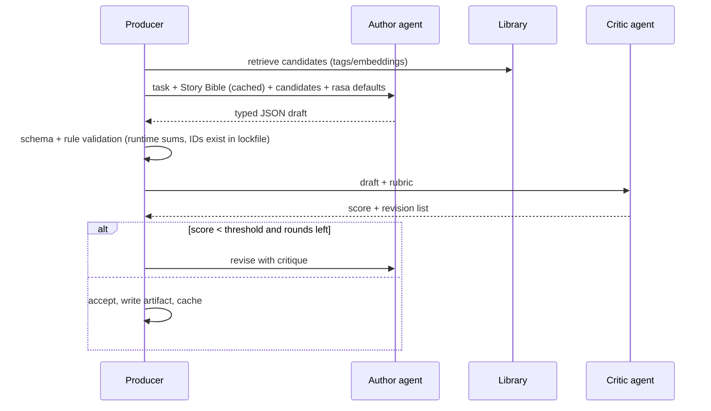

# The Brain: Agents and Decision Models

The pipeline uses two kinds of "models":

1. **Reasoning agents (LLM, Claude):** they read the story and make the creative calls:
   structure, dialogue, casting briefs, shot design, music direction, edit choices.
   They write **typed JSON** (validated against `src/nraiorbit/schemas.py`), never free text
   that downstream code has to parse.
2. **Specialist models:** small, fast, measurable models that **score and classify**:
   face identity, speaker identity, speech emotion, music emotion, aesthetics, Telugu text
   emotion. They feed the guards and the best-of-N selection. Over time you fine-tune them
   on your own approved/rejected takes, which is how the pipeline learns your taste.

---

## 1. Agent roster

| Agent | Responsibility | Reads | Writes | Default model / effort |
|---|---|---|---|---|
| **Producer** (orchestrator) | Runs the stage DAG, budgets, retries, review gates | config, all artifacts | stage status, cost reports | deterministic code, not an LLM |
| **Story Analyst** | Turns the plot into a Story Bible: genre, tone, world, characters with physical/voice/dialect specs, act/beat structure, rasa and intensity per beat, set-pieces | plot prompt, structure templates | `StoryBible` | `claude-opus-5-5`, effort `high` |
| **Screenwriter** | Scene outline for the whole film, then one scene script at a time, with dialogue in **spoken Telugu** per character dialect plus English subtitle text | Story Bible, outline, previous scene summary | `Outline`, `SceneScript` | `claude-opus-5-5`, effort `high` |
| **Dialogue Critic** | Reviews each scene for natural spoken Telugu: no bookish *grandhika* register, dialect consistency, code-mix level, punch-dialogue strength. Returns a revision list | `SceneScript`, character specs | `Critique` → Screenwriter revises | `claude-opus-5-5`, effort `medium` |
| **Casting & Character Designer** | Matches each character to a library asset or writes a full visual brief for a new identity pack; matches or briefs voices | character specs, library index | casting decisions → `cast.lock.yaml` | `claude-opus-5-5` + registry search |
| **Production Designer** | Locations, per-scene costumes, props, time of day, colour palette/LUT per sequence | outline, library locations | `ProductionDesign` | `claude-opus-5-5`, effort `medium` |
| **Director / Shot Planner** | Breaks each scene into shots: shot size, lens, camera move, blocking, action template, duration, rasa, intensity, trailer-candidate flag. Writes the image/video prompts | `SceneScript`, lockfile, action and camera library | `ShotList` | `claude-opus-5-5`, effort `high` |
| **Music Director** | Refines the deterministic cue plan: picks motifs, raga, tala, instrumentation, hit points, silence | rasa curve, cue plan, motif library | `CueSheet` | `claude-opus-5-5`, effort `medium` |
| **Editor** | Pacing decisions, trims, J/L-cuts, transitions, montage order | shot scores, timeline | `Timeline` | deterministic + LLM for montage choices |
| **Trailer Cutter** | Chooses trailer moments and order from shot scores and a trailer template, and picks the punch dialogues | shot scores, script | `TrailerPlan` | deterministic scorer + LLM pick of dialogue |
| **QA Critic** (vision) | Looks at keyframes/contact sheets for things the numeric guards miss: wrong costume, wrong era, extra limbs, cultural errors | images + shot spec | pass/fail + reasons | `claude-opus-5-5` with image input |

All agent prompts live in `src/nraiorbit/prompts/` as Markdown. They are versioned with
the code, so every artifact records which prompt version produced it.

---

## 2. How agents "take the right choices"

The design rule: **agents decide from evidence, not from vibes.** Every decision is
grounded in one of four sources:

1. **The Story Bible**, the single source of truth that every downstream call receives
   in its cached prefix.
2. **Taxonomies in config:** `navarasa.yaml` maps each rasa (emotion) to defaults for
   music (raga, tala, tempo, instruments), voice (pace, pitch, energy), camera (shot sizes,
   moves, frame rate) and lighting/palette. The agent starts from those defaults and has to
   justify any deviation.
3. **Library retrieval:** before writing a new asset brief, the agent gets the top-k
   matching assets from the registry (by tags, and by embedding in production). For
   example, the Director gets the matching `actions/` choreography templates for a fight
   beat, and the Music Director gets existing motifs and stems.
4. **Critique loops:** a critic agent scores the output against a rubric, then the author
   agent revises. The loop stops at a score threshold or after N rounds (default 2).

**Rule validation runs before the critic.** Deterministic checks are cheap and exact:
scene durations sum to the act budget, every `character_id` exists in the lockfile, every
dialogue line has a speaker, shot durations sum to scene length. A failed rule check goes
straight back to the author agent with the error message.

---

## 3. Specialist models

| Model | Purpose | Starting point | Fine-tune later on |
|---|---|---|---|
| Face identity embedder | Identity guard, face→character assignment | InsightFace ArcFace (`buffalo_l` / `antelopev2`) | — (calibrate thresholds only) |
| Person/body re-ID | Body, build, costume consistency | DINOv2 / SigLIP embeddings of person crops, OSNet re-ID | approved/rejected crops |
| Speaker embedder | Voice guard | SpeechBrain ECAPA-TDNN, WeSpeaker | — (calibrate) |
| Telugu ASR | Check spoken audio matches script (CER) | AI4Bharat IndicConformer, Whisper large-v3 | your dialogue takes |
| Speech emotion recognition | Did the line land with the intended emotion? | emotion2vec | labelled takes from your voice bank |
| Speech quality (MOS) | Reject robotic or noisy takes | UTMOS / DNSMOS | — |
| Telugu text emotion | Cross-check the rasa tags the Screenwriter assigned | MuRIL / IndicBERT v2 fine-tuned on rasa-labelled lines | your scripts |
| Image aesthetic scorer | Best-of-N keyframe selection | LAION aesthetic predictor / CLIP-based | your keep/reject decisions |
| Video artifact detector | Morphing hands, flicker, melting faces | frame-difference + optical-flow heuristics, VLM critic | rejected takes |
| Music emotion (valence/arousal) | Score fits the scene | Essentia mood models | your cue approvals |
| Raga conformance | Score stays inside the chosen raga | pitch tracking (Essentia/CREPE) → pitch-class histogram vs raga scale | — |
| Trailer moment scorer | Rank shots for the trailer | weighted features (intensity, action energy, aesthetics, lead presence, punch-line score) | which shots you keep in trailers |

### 3.1 The feedback flywheel

Every guard decision and every human approve/reject is logged to `reports/guards.jsonl`
with the take, its scores and the verdict. After the first short film you have labelled
data to:

- recalibrate thresholds per character and shot type,
- train a reward model (logistic regression or a small MLP on embeddings) that predicts
  "you would keep this take", and use it to rank best-of-N,
- fine-tune the text-emotion and music-emotion classifiers on Telugu content.

This is the pipeline's learning loop. The LLM agents stay general; the specialist
models learn your taste.

---

## 4. LLM integration details

Implemented in `src/nraiorbit/llm.py`:

- **Model:** `claude-opus-5-5` with adaptive thinking (always on for this model). Depth
  is set per agent with `output_config.effort`.
- **Structured outputs:** each agent passes its Pydantic schema as `output_format`, and
  the SDK returns a validated instance (`parsed_output`). No regex parsing.
- **Streaming:** long outputs (scene scripts, shot lists) are streamed and collected
  with `get_final_message()` to avoid HTTP timeouts.
- **Prompt caching:** the system prompt and Story Bible go in a stable prefix with
  `cache_control`. Per-scene calls only pay full price for the scene-specific suffix.
- **Refusal fallback:** requests opt into server-side `fallbacks: "default"` (beta
  `server-side-fallback-2026-07-01`). If a request is declined anyway, the client
  raises a clear error instead of returning empty JSON. Violent action scenes are normal
  film content, but describe them in cinematic terms (choreography, impact, reaction),
  not as gore.
- **Batching:** non-urgent per-scene calls can go through the Message Batches API at 50%
  cost (no server-side fallback there; retry declines individually).
- **Replay client:** `ReplayLLM` returns recorded fixtures for tests and offline dry runs.

LLM cost is small next to video generation: a full feature's story, screenplay and shot
planning, with critique loops, is in the tens of dollars.
