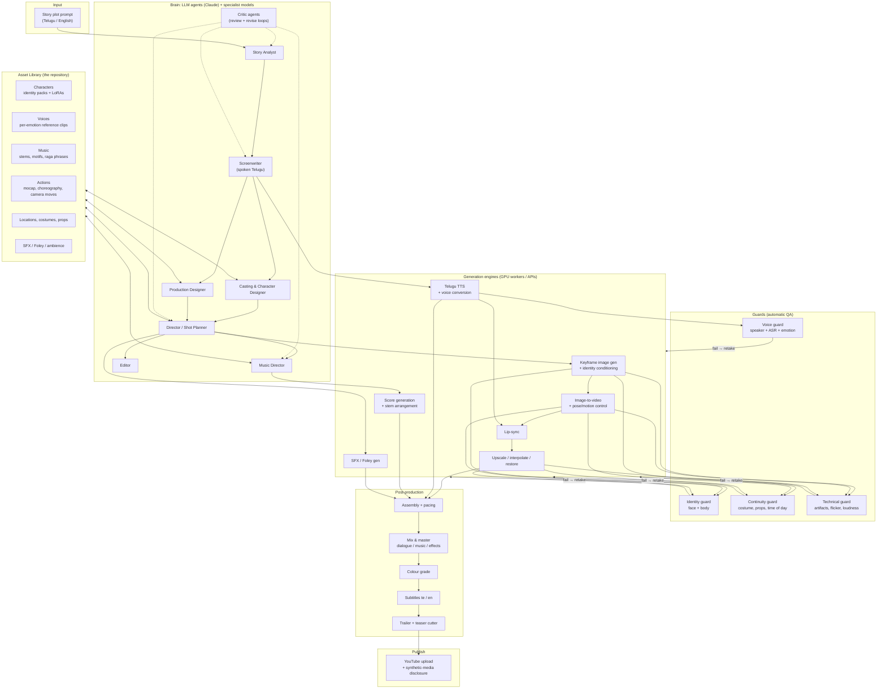
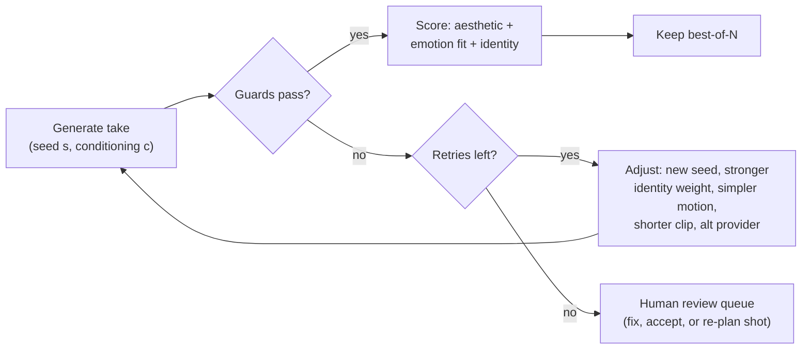

# NRAIORBIT Agentic Film Productions — System Architecture

> **Goal:** take a story plot as a prompt and produce, with as little manual work as
> possible, a **1h45m Telugu feature film** plus a **teaser and trailer**, ready to publish
> on YouTube. Characters keep the same face and body for the whole film. Dialogue sounds
> like real spoken Telugu. The background score uses native Telugu/Carnatic/folk idioms
> and follows the emotion and action of each scene.

This document is the top-level design. Deep dives:

| Doc | What it covers |
|---|---|
| [AGENTS.md](AGENTS.md) | The decision-making "brain": LLM agents, specialist ML models, critique loops |
| [CHARACTER_IDENTITY.md](CHARACTER_IDENTITY.md) | Character identity guard: same face and body in every shot |
| [VOICE_TELUGU.md](VOICE_TELUGU.md) | Telugu dialogue, dialects, emotional TTS, voice cloning, voice guard |
| [MUSIC_TELUGU.md](MUSIC_TELUGU.md) | Navarasa → raga/tala/instrument mapping, cue planning, score generation |
| [ASSET_LIBRARY.md](ASSET_LIBRARY.md) | The asset repository (characters, voices, music stems, actions, locations, SFX) |
| [TOOLS.md](TOOLS.md) | Every tool and model the pipeline needs, with licences and alternatives |
| [INFRA_COST_ROADMAP.md](INFRA_COST_ROADMAP.md) | Infrastructure, GPU sizing, cost estimates, compliance, phased roadmap |

---

## 1. Scale check: what "1h45m" means

A realistic plan has to start from the numbers:

| Quantity | Estimate | How it is derived |
|---|---|---|
| Runtime | 6,300 s | 105 min |
| Scenes | 60–90 | Telugu commercial films average 1–2 min per scene |
| Shots | ~1,200–1,600 | Average shot length 4–5 s (dialogue scenes run longer, fights shorter) |
| Video generations | ~4,000–5,000 | Video models produce 5–10 s clips; plan for ~3 takes per shot that is kept |
| Keyframe images | ~5,000–6,000 | ~4 candidates per shot before the best one is animated |
| Dialogue lines | ~1,200–1,800 | Each with 2–3 voice takes |
| Music cues | 60–90 | ~70–80 min of score, plus optional songs |

So this is a **production-management system** first and a model-calling script second.
Every shot, take, line and cue must be tracked, cached, scored, retried and reviewed.
The architecture below is built around that.

---

## 2. System overview



The architecture has seven layers:

1. **Brain:** LLM agents make the creative decisions: story, screenplay, casting,
   shots, music, edit. Specialist models score and classify. See [AGENTS.md](AGENTS.md).
2. **Asset library:** a versioned repository of characters, voices, music, actions,
   locations and SFX. Agents *retrieve* from it before they *generate*. Once casting
   picks an asset, its ID is pinned in the project lockfile, which keeps the film
   consistent. See [ASSET_LIBRARY.md](ASSET_LIBRARY.md).
3. **Generation engines:** pluggable providers (self-hosted open models through ComfyUI
   or Python workers, or commercial APIs) behind one interface per capability, so a better
   model can replace an old one without pipeline changes.
4. **Guards:** automatic QA after every generation. A failed check triggers a retake with
   stronger conditioning. A take that keeps failing goes to the human review queue.
5. **Post-production:** timeline assembly, mixing, grading, subtitles, trailer.
6. **Publish:** YouTube upload with metadata, captions, chapters and the
   altered/synthetic-content disclosure.
7. **Orchestration** (spans all layers): durable workflow engine, GPU queues,
   content-addressed caching, cost tracking, review UI. See
   [INFRA_COST_ROADMAP.md](INFRA_COST_ROADMAP.md).

---

## 3. Pipeline stages

Each stage reads typed artifacts (Pydantic models in `src/nraiorbit/schemas.py`) and
writes typed artifacts. All of them are cached by content hash, so a re-run only redoes
what changed.

| # | Stage | Agent / engine | Input → Output | Guard / gate |
|---|---|---|---|---|
| S0 | **Ingest** | — | prompt → `input/story.md`, project config | — |
| S1 | **Story analysis** | Story Analyst | plot → **Story Bible** (logline, world, characters, themes, act/beat structure with rasa + intensity per beat) | Critic loop; **human gate: story** |
| S2 | **Outline** | Screenwriter | Story Bible → **Scene outline** (60–90 scenes with runtime budget, rasa curve, set-pieces) | Runtime planner checks total = 105 min ± 3 |
| S3 | **Screenplay** | Screenwriter (one call per scene) | scene outline → **Scene scripts**: action + spoken-Telugu dialogue per character dialect, delivery tags, English subtitle text | Telugu dialogue critic (naturalness, dialect, code-mix level) |
| S4 | **Casting** | Casting & Character Designer | characters → library match **or** new identity pack; voice match **or** new voice; leitmotif | **human gate: cast**; writes `cast.lock.yaml` |
| S5 | **Production design** | Production Designer | scenes → locations, costumes per scene, props, time of day, palette/LUT | Continuity plan |
| S6 | **Shot planning** | Director | scene script → **Shot list** (type, lens, move, blocking, action template, duration, rasa, intensity, trailer-candidate flag) | Shot durations sum to scene budget |
| S7 | **Animatic** | Mock providers + editor | shot list + temp TTS → placeholder cut with real timings | **human gate: pacing** (cheap; catches problems before GPU spend) |
| S8 | **Dialogue performance** | TTS + voice conversion | lines → WAV per line (emotion-matched reference, dialect lexicon) | Voice guard: speaker similarity, ASR CER, emotion, MOS |
| S9 | **Keyframes** | Image gen + identity LoRA/adapter + pose/depth control | shot → N candidate stills | Identity + continuity + aesthetic scoring; best-of-N |
| S10 | **Shot video** | Image-to-video (+ pose/motion control for action) | keyframe (+ end frame) → clip | Identity guard on sampled frames, temporal drift, artifact detector; retakes |
| S11 | **Lip-sync & finish** | Lip-sync, face restore, upscale, frame interpolation | clip + dialogue WAV → final shot | Identity guard again (restoration can drift a face) |
| S12 | **Score** | Music Director → cue sheet → composer engine | rasa curve + edit timings → cues (stems) | Music guard: raga conformance, valence/arousal match, loudness |
| S13 | **Sound design** | SFX/Foley engine | shot actions + locations → SFX/ambience tracks | Sync check |
| S14 | **Edit & master** | Editor | everything → timeline (OTIO), colour, D/M/E mix, -14 LUFS master, subtitles | **human gate: final cut** |
| S15 | **Trailer & teaser** | Trailer cutter | shot scores + template → 2:15 trailer, 0:60 teaser, thumbnails | **human gate: trailer** |
| S16 | **Publish** | YouTube publisher | masters → upload, captions, chapters, disclosure | Final QC checklist |

Every gate can be set to `auto_approve` in `config/pipeline.yaml` for fully unattended
runs. Leave **story**, **cast** and **final cut** on until the guards have been
calibrated on your own content.

### 3.1 Why generation is hierarchical

A 105-minute screenplay does not fit in one well-crafted LLM response, and consistency
breaks when everything is generated at once. The pipeline therefore narrows step by step:

```
Story Bible (1 call)  ─┐
                       ├─► Scene outline (1 call, whole film)  ─► Scene script ×N  ─► Shot list ×N
Project lockfile ──────┘      (runtime budget, rasa curve)         (cached prefix:     (cached prefix:
                                                                    bible + outline)    bible + script)
```

The Story Bible and outline sit in a cached prompt prefix for every per-scene call. That
keeps each scene consistent with the whole film and makes the calls cheap.

### 3.2 Telugu commercial structure template

The runtime planner (`src/nraiorbit/planning/runtime.py`) ships with structure
templates. The default `telugu_commercial` template for 105 minutes:

| Block | Minutes | Typical content |
|---|---|---|
| Opening / world | 0–8 | Establish the world, villain threat or mystery |
| Hero introduction | 8–15 | Hero intro (elevation BGM, slow-motion entry, intro fight or intro song) |
| Act 1 development | 15–35 | Romance, comedy track, family sentiment, conflict set-up |
| Act 2A escalation | 35–55 | Conflict rises; stakes revealed |
| **Interval bang** | 55–58 | Big twist or mass moment; the cliffhanger before the interval |
| Act 2B / flashback | 58–80 | Flashback or backstory, emotional core, escalation |
| Pre-climax | 80–90 | Low point, revelation, hero's resolve |
| Climax | 90–100 | Climax fight / confrontation, peak score |
| Resolution | 100–105 | Emotional payoff, end title |

Other templates: `family_drama`, `thriller`, `village_action`. The Story Analyst picks one
from the plot, or you can force one in config.

---

## 4. The project lockfile is the "guard trail"

Consistency is enforced, not hoped for. Once casting is approved, `cast.lock.yaml` pins:

```yaml
characters:
  arjun:
    asset: characters/arjun_hero@v3          # identity pack version
    face_centroid_sha256: 9f2c…              # embedding the identity guard compares to
    lora: characters/arjun_hero/lora/arjun_flux_v3.safetensors
    costumes: {default: cst_arjun_village, climax: cst_arjun_climax_torn}
    voice: voices/arjun_voice@v2
    leitmotif: music/motifs/arjun_theme@v1
```

Every downstream stage reads assets **only through the lockfile**. No agent can introduce
a new face or voice for an existing character. A change means a new lockfile version, and
the shots that used the old asset are invalidated automatically.

---

## 5. Retake loop (shared by all generators)



The retake policy is per shot type (`config/pipeline.yaml → retakes`). Close-ups get
stricter identity thresholds. Wide action shots get looser ones, since faces are small
there and the body/costume checks carry more weight.

---

## 6. Data and storage layout per project

```
projects/<slug>/
  input/story.md                 # the plot prompt
  01_story_bible.json
  02_outline.json
  03_scenes/<scene_id>.json      # scene scripts (dialogue in Telugu script + English)
  04_shots/<scene_id>.json       # shot lists
  cast.lock.yaml                 # pinned assets (the guard trail)
  05_dialogue/<line_id>/take_<n>.wav
  06_keyframes/<shot_id>/take_<n>.png
  07_video/<shot_id>/take_<n>.mp4
  08_music/<cue_id>.wav (+ stems/)
  09_sfx/<shot_id>.wav
  10_edit/timeline.json          # edit decision list (shots, dialogue, music placements); exportable to OTIO
  11_master/movie.mp4  trailer.mp4  teaser.mp4  subs_te.srt  subs_en.srt  thumbnail.png
  reports/guards.jsonl           # every guard decision, for calibration
  reports/cost.jsonl             # every provider call with cost and latency
  reviews/<gate>.{pending,approved}
```

Media files live in object storage (S3/R2/GCS/MinIO). Metadata such as shots, takes,
scores and costs goes in Postgres. Embeddings for faces, voices and asset search go in
pgvector or Qdrant. The JSON artifacts above are the source of truth and can be
regenerated into the database.

---

## 7. Code layout (this repository)

```
config/
  pipeline.yaml          # providers, thresholds, gates, retakes, runtime target
  navarasa.yaml          # emotion taxonomy → music / voice / camera / lighting defaults
library/                 # the asset repository (manifests in git; binaries in LFS/object storage)
examples/                # sample story prompts
src/nraiorbit/
  schemas.py             # all data contracts between stages
  config.py              # config loading
  llm.py                 # Claude client (structured outputs, caching, fallbacks) + replay client
  prompts/*.md           # versioned agent system prompts
  agents/                # story analyst, screenwriter, casting, director, music director
  library/registry.py    # asset manifest loading, validation, retrieval, lockfile
  guards/                # identity guard, voice guard
  planning/              # runtime budget planner, music cue planner
  providers/             # capability interfaces + mock (ffmpeg) implementations
  post/                  # assembly + mix (ffmpeg), trailer cutter, subtitles
  publish/youtube.py     # YouTube upload with synthetic-media disclosure, captions, chapters
  pipeline.py            # stage orchestrator with caching, guards, retakes and review gates
  demo.py                # recorded agent outputs for the offline demo and tests
  cli.py                 # `nraiorbit` command
tests/
```

The scaffold runs end to end today in **mock mode**: story → screenplay → shots →
animatic movie and trailer, using placeholder video and audio rendered by ffmpeg. To move
to production, swap each mock provider for a real one (see [TOOLS.md](TOOLS.md)). The
pipeline itself does not change.
