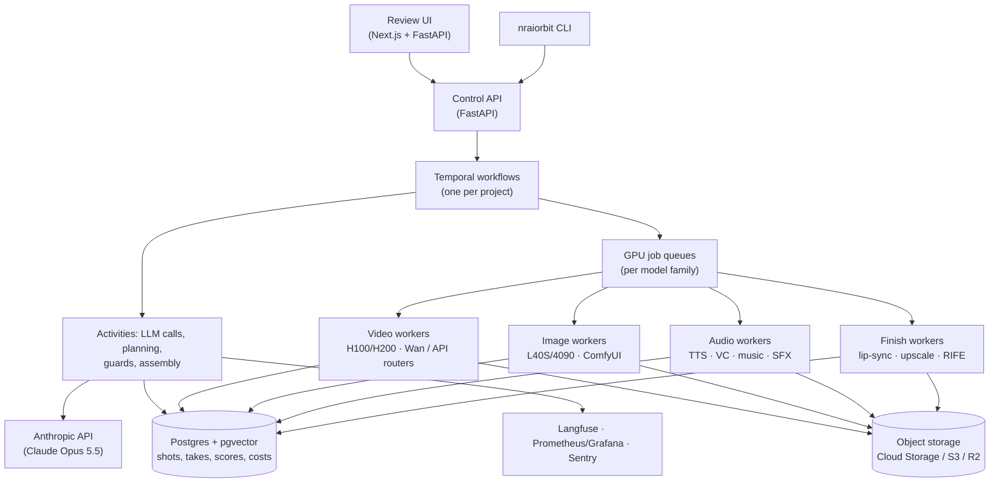

# Infrastructure, Cost, Compliance and Roadmap

## 1. Deployment architecture

Principles:

- **Idempotent, content-addressed jobs.** A take's ID is the hash of (provider, model
  version, prompt, seed, conditioning asset versions). Re-running a project never
  regenerates an identical take.
- **One queue per model family** keeps model weights hot in GPU memory. Switching models
  costs minutes.
- **Scale to zero** with KEDA/Ray autoscaling between productions. GPUs are the main cost.
- **Everything is logged:** cost, latency and guard scores per take (`reports/*.jsonl` and
  Postgres) feed the calibration and reward-model loop.

## 2. Compute and cost estimate (feature film, 105 min)

These are **planning estimates** with stated assumptions. Prices and model speeds change
quickly; measure your own per-shot cost on the 5-minute pilot (Phase 1) and re-project.

**Assumptions:** 1,400 shots, about 3 video takes per kept shot (4,200 clips of about
5 s), 4 keyframe candidates per shot, 720p generation upscaled to 1080p/4K, lip-sync on
about 40% of shots, 1,500 dialogue lines × 3 takes.

### Option A: mostly self-hosted open models

| Workload | Volume | GPU time (H100-class) |
|---|---|---|
| Video I2V | 4,200 clips | ~3–8 min each → **210–560 h** |
| Keyframes | 5,600 images | ~10–20 s each → 15–30 h |
| LoRA training | 10–15 characters | ~1 h each → 10–15 h |
| Lip-sync | ~560 shots | 20–40 h |
| Upscale + interpolation | final takes only | 15–30 h |
| TTS / VC / music / SFX | — | 10–20 h |
| **Total** | | **≈ 300–700 GPU-hours** |

At typical on-demand H100 rates of a few dollars per hour, that is roughly **$1k–$3k** in
compute per film, plus storage (~0.5–1 TB including all takes). On 8 GPUs the bulk render
takes about **2–4 days** of wall-clock time.

### Option B: mostly commercial video APIs

Video APIs price per second of output. Across common providers this ranges from roughly
$0.05 to over $0.50 per second depending on model and resolution. 21,000 generated seconds
(4,200 × 5 s) is therefore roughly **$1k–$10k+** for video alone. Use APIs for hero shots,
self-hosted models for volume.

### Other costs

| Item | Estimate |
|---|---|
| Claude (story, screenplay, shots, critique, vision QA) | tens of dollars per film (prompt caching on the Story Bible prefix) |
| Voice artists (one-time voice bank + path-A scratch reads for leads) | depends on local rates; budget for consent contracts |
| Music stem library (one-time commissioning) | the biggest one-time creative investment; reused across films |
| Human review time | ~1–3 days per film at the gates once calibrated |

## 3. Compliance checklist

**YouTube**

- [ ] Disclose altered/synthetic content: set `status.containsSyntheticMedia` on upload
      (or tick the checkbox in YouTube Studio). Realistic AI-generated people and scenes
      require it.
- [ ] Monetisation: the YouTube Partner Program's *inauthentic content* policy targets
      mass-produced, repetitive content. A story-driven film with clear creative direction
      is a different thing, but keep a record of your creative input (story, casting
      decisions, edit approvals). The review gates produce that record.
- [ ] Verify the channel: uploads longer than 15 minutes require a verified account.
- [ ] Upload captions (Telugu + English), chapters (from the scene outline), a custom
      thumbnail and an end screen pointing to the trailer.
- [ ] Master loudness around −14 LUFS integrated. YouTube normalises playback, so a
      hotter master just gets turned down.

**Rights and consent**

- [ ] Every face is synthetic or from a consenting performer (`consent.document_ref`).
- [ ] No real celebrity likenesses, political figures or real private persons.
- [ ] Every voice comes from a consenting artist under an AI-voice contract.
- [ ] Every music stem and SFX has `license.commercial_use: true`.
- [ ] Every model's licence allows commercial use of its outputs (see ⚠ items in
      [TOOLS.md](TOOLS.md)).
- [ ] Generated music doesn't imitate a specific existing song or composer by name.
- [ ] Keep the per-take provenance log (provider, model version, prompt) for disputes and
      Content ID claims.

**Content**

- [ ] Action violence is staged and cinematic, not gratuitous gore (affects YouTube age
      restriction and ad suitability).
- [ ] Religious and caste depictions reviewed by a human for sensitivity.

## 4. Phased roadmap

| Phase | Duration | Deliverable | Exit criteria |
|---|---|---|---|
| **P0: Foundation** | 2–3 weeks | This scaffold running end to end in mock mode; library schema; 1 identity pack; 1 voice; 30 stems; animatic of a 10-scene story | `nraiorbit run --mock` produces an animatic movie + trailer; tests green |
| **P1: Pilot short** | 4–6 weeks | **5-minute Telugu short**, fully generated: 2 characters, 1 fight, 1 emotional scene, real BGM | Identity guard calibrated (EER measured); voice guard calibrated; per-shot cost known |
| **P2: Episode** | 6–8 weeks | **20-minute film** + trailer; review UI; Temporal + GPU autoscaling; retake queue | ≤ 10% of shots need human intervention; trailer cutter accepted by you |
| **P3: Feature** | 8–12 weeks | **105-minute feature** + teaser + trailer, published on YouTube | Passes the compliance checklist; full cost report |
| **P4: Learning studio** | ongoing | Reward models trained on your approvals; fine-tuned Telugu emotion/music models; songs pipeline; franchise character reuse | Human review time per film keeps going down |

Start with P1 rather than P3. A 5-minute short exercises every stage and every guard, and
the cost and quality numbers it produces are what you need to plan the feature.
