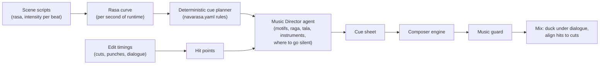

# Telugu Background Score: Native, Emotional, Mass

Generic text-to-music models produce generic "Indian-flavoured" music. A Telugu film score
needs raga-correct melody, real percussion idioms (dappu, thavil, mridangam, chenda), the
"elevation" grammar of mass scenes, and silence in the right places. The design is
therefore a **hybrid**: real recorded material and rule-driven composition give the music
its authenticity, and generative models fill in textures and variations.

---

## 1. From emotion curve to cue sheet



`src/nraiorbit/planning/music.py` builds the first cue plan deterministically:

1. Take each scene's primary rasa and intensity.
2. Merge adjacent scenes with the same rasa into one cue (`merge_adjacent_same_rasa`), up
   to `max_cue_seconds` (240 s). Set-piece scenes always get a cue of their own.
3. Choose raga, tala, tempo and instruments from `config/navarasa.yaml`, scaled by
   intensity (higher intensity: faster tempo from the range, heavier percussion).
4. Attach the **leitmotif** of the lead character in the scene (hero, heroine, villain).
5. Mark set-pieces (hero intro, interval bang, climax) as `peak` cues with a short
   silence before the hit.

The Music Director agent then refines the plan. It can override any default but has to
write down why (for example, "use the hero theme in Shivaranjani here: the heroism is
tragic in this flashback").

---

## 2. Navarasa → music mapping (defaults)

Full data lives in `config/navarasa.yaml`. Summary:

| Rasa | Typical Telugu cue | Ragas (defaults) | Tala | BPM | Signature instruments |
|---|---|---|---|---|---|
| Shringara (love) | romance theme, song bridge | Mohanam, Kalyani, Abheri, Hindolam | Adi, Rupaka | 70–96 | flute (venu), veena, strings, santoor |
| Hasya (comedy) | comedy sting / bed | Bilahari, Mohanam | Adi, Khanda Chapu | 100–132 | mandolin, ghatam, kanjira, morsing, pizzicato |
| Karuna (pathos) | sentiment, mother sentiment | Shivaranjani, Subhapantuvarali, Mukhari, Charukesi | Rupaka, Misra Chapu, free | 50–72 | Carnatic violin solo, slow nadaswaram, cello, female alaap |
| Raudra (fury) | rage build, villain theme | Atana, chromatic hybrid | Adi, Khanda Chapu | 120–160 | thavil, chenda, dappu, low brass, distorted guitar |
| **Veera (heroism)** | **hero elevation / mass BGM**, interval bang, climax | Nattai, Arabhi, Hamsadhwani | Adi, teenmaar folk | 110–150 | dappu, thavil, chenda, nadaswaram, epic brass, Sanskrit choir, whistles/claps |
| Bhayanaka (fear) | dread bed, jump sting | textural | free | 40–70 | drones, dissonant strings, reverse swells |
| Bibhatsa (disgust) | disgust sting | textural | free | 50–80 | detuned strings, metallic scrapes |
| Adbhuta (wonder) | reveal | Kalyani, Vasantha | Rupaka, free | 60–90 | choir, harp, veena glissando, temple bells |
| Shanta (peace) | resolution | Revati, Hindolam | free, Rupaka | 50–70 | tanpura, veena, flute |
| Vatsalya (family love) | family theme | Neelambari, Ananda Bhairavi | Rupaka, Misra Chapu | 55–76 | lullaby hum, veena, flute |
| Bhakti (devotion) | temple, festival | Mayamalavagowla, Revati, Bhairavi | Adi, Rupaka | 60–100 | nadaswaram, thavil, bells, conch, chant |

These are starting points. Have a Telugu music director review and adjust them for your
style before the first production.

### The "mass elevation" recipe (hero entry, interval bang, climax)

```
0.0s   low drone + heartbeat sub hits (anticipation)
       ↓ 4–8 bars of rising dappu/thavil roll, tempo locked to the cut rhythm
-1.5s  SILENCE (or a single breath / whoosh)                 ← silence_before_peak_seconds
 0.0s  HIT: full percussion + brass + choir on the slow-motion reveal frame
       hero leitmotif stated in Nattai/Arabhi on nadaswaram or brass
       whistle/clap layer for "theatre" energy
+8s    groove section (teenmaar or Adi tala) under the walk / fight
```

The Editor gives the composer engine exact frame times for the reveal and each punch
impact, so hits land on the cut.

---

## 3. Composer engine (three sources, mixed)

| Source | What | Why |
|---|---|---|
| **A. Stem library (recorded)** | Licensed or commissioned multitracks from Telugu/Carnatic/folk musicians: percussion grooves per tala and tempo, nadaswaram/flute/violin phrases per raga, choir chants, dappu/teenmaar loops, risers, hits. Tagged with raga, tala, BPM, key (Sa), rasa, intensity | Authenticity. This is the asset that makes the score sound Telugu rather than "AI Indian" |
| **B. Symbolic composition** | Rule-based MIDI generation inside the raga scale (arohana/avarohana, characteristic phrases, gamaka hints), motif development (augmentation, rhythmic variation, re-harmonisation), rendered with sampled instruments | Deterministic, editable, always in raga, time-locked to the edit |
| **C. Generative audio** | Text/melody-conditioned music models for pads, textures, transitions and variations, ideally fine-tuned on your licensed stems; or commercial music APIs whose terms allow commercial YouTube use | Fills gaps and adds variety |

Arrangement per cue: groove (A) + motif melody (B, rendered) + texture (C) + hits/risers
(A), then stem mixing with sidechain ducking under dialogue
(`cue_rules.dialogue_duck_db`).

### Leitmotifs

During casting, each lead gets a motif stored in `library/music/motifs/` (MIDI + rendered
stems + the raga it was written in). Cues state the motif in the current scene's raga, so
the hero theme in Nattai at the intro becomes the same melody in Shivaranjani at the
emotional low point. Motif reuse is a big part of what makes a score feel composed rather
than assembled.

### Songs (optional, phase 3)

Telugu films usually have 4–6 songs. A **Lyricist agent** can write Telugu lyrics to a
tune's syllable grid (*chandassu*-aware), but sung vocals are the hardest part to get
right. Recommended: hire a singer for the vocal, or use singing-voice synthesis trained
only on a consenting singer's licensed recordings. Song sequences use the same shot
pipeline with choreography templates from `library/actions/`.

---

## 4. Music guard

| Check | Method | Default |
|---|---|---|
| Raga conformance | Pitch tracking of the melodic stem → pitch-class histogram (relative to the cue's Sa) → share of energy outside `raga_scales[raga]` | ≤ 12 % out-of-raga |
| Emotion fit | Valence/arousal model vs target rasa's region | inside region |
| Tempo / hit sync | Beat tracking vs requested BPM; onset at each hit point within ±40 ms | pass |
| Loudness | Cue stems at consistent LUFS before mixing | ±1 LU |
| Licence | Every stem in the cue has a manifest with a commercial-use licence | required |
| Originality | Fingerprint check of generated material against your reference catalogue; avoid prompts naming existing songs or composers | no match |

---

## 5. Sound design (SFX, Foley, ambience)

The Director's shot list contains `sfx_cues` (e.g. `punch_heavy`, `bike_rev`,
`sword_unsheath`, `crowd_cheer_te`). They are resolved in this order:

1. library match from `library/sfx/` (licensed packs, your own recordings),
2. video-to-audio Foley generation for movement-synchronous sounds,
3. text-to-SFX generation for anything else.

Ambience beds come from the location type (village morning, temple, market, highway
night, rain). **Telugu crowd walla** (background chatter, cheering, festival crowds) should
be recorded or licensed from Telugu speakers. Generic crowds sound wrong to a Telugu
audience.
